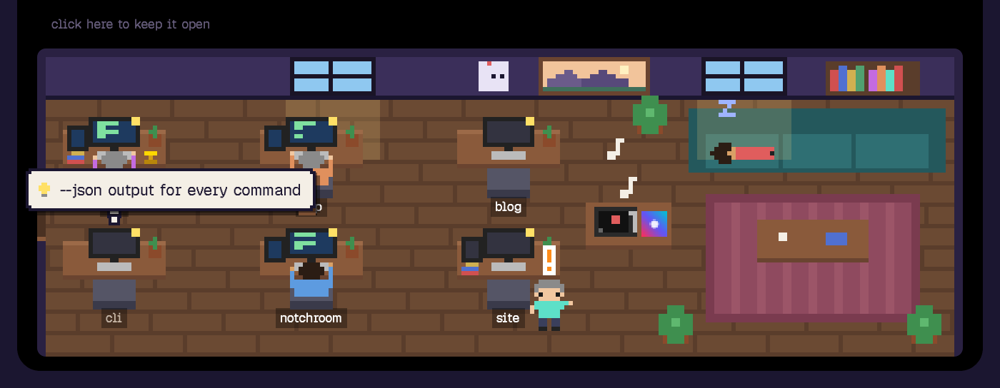
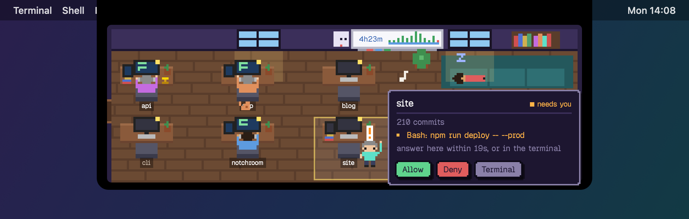
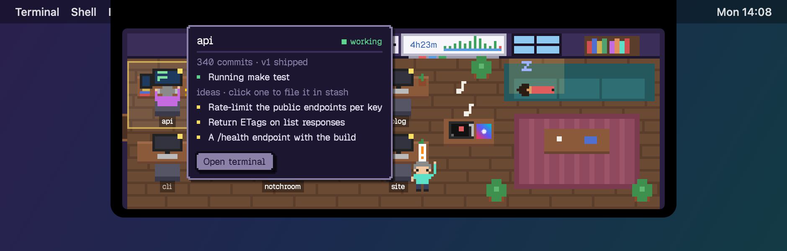
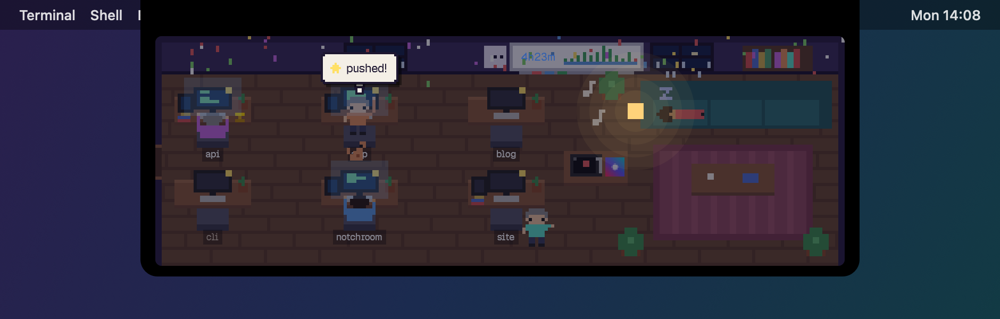
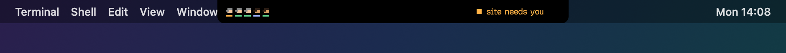

# notchroom

[](https://github.com/pyvnoaim/notchroom/actions/workflows/ci.yml)
[](LICENSE)

**A pixel office in your MacBook's notch, where every Claude Code session is a character.**



Running several Claude Code sessions at once means tabbing around to find out which one is busy, which one is done and which one has been waiting for your permission for ten minutes. notchroom puts them all in one small room that drops down from the notch when you hover it. Each recently active project gets a desk. Sessions walk in through the door, type at their project's desk while they work, stand up and wave when they need you, and nap on the couch when they're done.

## Features

- **See every session at a glance.** Working, waiting for you, or idle, each one drawn where it is. Collapsed, the notch shows a head per session and one line of news: who needs you, or what the latest work is.
- **Answer permission requests from the notch.** When a session asks to run something, the room opens with the full command and **Allow**, **Deny** and **Terminal** buttons.
- **Jump to the right terminal.** Click a character to bring its terminal to the front (in Ghostty, the exact terminal).
- **What everyone is doing.** Hover a desk: "Running make test", "Editing Room.swift", plus the project's commit count.
- **Ideas on every desk.** Once a day per project, Claude Haiku reads the README and recent commits and pitches a few small features, which show up as speech bubbles. Click one to file it in [stash](https://github.com/pyvnoaim/stash).
- **The real sky.** Sunrise, dusk and night follow the sun where your time zone says you are, and the windows show rain or snow when it's actually raining or snowing there. At night the lamp comes on.
- **Today on the whiteboard.** Active time and a bar chart of the last twelve hours; hover it for the numbers per project.
- **A party for green tests.** A passing test run or a `git push` throws confetti and the project's character dances.
- **Small things.** A record player that shows what [resona](https://github.com/pyvnoaim/resona) is playing (everyone bobs along), desks that collect plants, screens, books and a trophy as their projects grow, and a cat named Byte who sits on the keyboard of whatever you've been ignoring longest.
- **No dependencies.** Plain Swift and AppKit, built with the Xcode Command Line Tools.

| A permission request | A desk's card |
| --- | --- |
|  |  |
| **A rainy night, right after a push** | **Collapsed** |
|  |  |

## Requirements

- macOS 12 or later, Apple Silicon or Intel. A notch is optional: without one, notchroom hangs from the top center of your main display.
- [Claude Code](https://claude.com/claude-code)
- To build: Xcode Command Line Tools with Swift 5.9 or later (`xcode-select --install`)

## Install

```sh
git clone https://github.com/pyvnoaim/notchroom.git
cd notchroom
make install
```

`make install` does three things:

- copies the binary to `~/.local/bin/notchroom` (set `PREFIX=` to put it elsewhere)
- adds notchroom's hooks to `~/.claude/settings.json`, keeping everything else in that file as it was (a backup goes next to it as `settings.json.bak-notchroom`)
- adds a LaunchAgent so notchroom starts at login and restarts if it ever crashes

Sessions that are already running pick up the hooks the next time they start. After pulling changes, `make update` rebuilds and restarts it.

## Usage

Hover the notch to open the room. Everything in it has a card when you hover it:

| Hover | Shows | Click |
| --- | --- | --- |
| A character or a desk | the project, what each session is doing, any permission question, the ideas | the character's terminal comes to the front |
| An idea in a card | | files it in stash and takes it off the desk |
| The whiteboard | today's active time, tool calls and sessions, per project | |
| The record player | the song, with its cover | |
| The cat | where it is napping | it says hi |

The room also opens by itself for a few seconds when a session starts waiting for you, or when a party starts.

### Permission requests

When a session needs permission, its card shows the full command and three buttons. **Allow** and **Deny** answer for you; **Terminal** hands the question back to the terminal's own prompt. If nothing is clicked within 20 seconds, the terminal gets it anyway. notchroom only holds a request while it is running, so with notchroom closed, permission prompts behave exactly as before.

## Configuration

Settings live in `~/.claude/notchroom/config`, one `key = value` per line:

```ini
# the folder that holds your repos; each recently touched one gets a desk (default: ~/dev)
projects = ~/code
# repos that never get a desk
skip = old-experiment, scratch
```

## Integrations

All optional. notchroom works without any of them.

- **Ghostty.** Clicking a character focuses the exact terminal it runs in, matched by directory. macOS asks once whether notchroom may control Ghostty. Other terminals are brought to the front as a whole.
- **stash.** Filing an idea runs `claude -p` with only the `stash_capture` tool of a Claude Code MCP server named `stash`, so it uses the stash login Claude Code already has. The idea is filed as `<idea> @<project> #idea`.
- **resona.** The record player reads `~/.resona/now-playing`, which resona writes whenever the song changes.

## How it works

Claude Code runs `notchroom --hook` on every hook event (session start and end, prompts, tool calls, permission requests, notifications, stop). The hook turns each event into a small state file, and the app in the menu bar reads those once a second.

| Where | What |
| --- | --- |
| `~/.claude/notchroom/<session>.json` | each session's state, what it is doing, its permission question, its process |
| `~/.claude/notchroom/log/` | one line per hook event for the whiteboard, kept for a week |
| `~/.claude/notchroom/ideas/` | each project's ideas, refreshed daily |
| `~/.claude/notchroom/party` | the last push or green test run |
| `~/.claude/notchroom/answers/` | Allow / Deny clicks, picked up by the waiting hook |
| `~/.claude/notchroom/config` | your settings |

A session that crashes without saying goodbye disappears once its process is gone. Commit counts come from `git`, the sun's position is computed locally, and the coordinates are the main city of your time zone (from the system's `zone.tab`), so notchroom never asks for your location.

## Privacy

Two things leave your Mac:

- **Weather**, every ten minutes, from [open-meteo](https://open-meteo.com) (no account, no key). The request carries your time zone's city coordinates, rounded to a tenth of a degree.
- **Ideas and filing to stash** go through `claude -p` with your own Claude Code login: the first 3 KB of each project's README and its last twelve commit messages, about one small Haiku request per desk per day. These runs have no tools (or only `stash_capture`), so they can't read or change anything else.

Everything else stays in `~/.claude/notchroom`.

## Development

```sh
make              # build ./notchroom
make test         # the self-check: hook parsing, ideas, stats, the sun, coordinates
./notchroom       # run it in the foreground (stop the installed one first: launchctl bootout gui/$(id -u)/xyz.pyvno.notchroom)
make screenshots  # redraw the pictures in docs/ from made-up projects
```

```
Sources/
├── main.swift       command-line entry point
├── App.swift        the notch panel: placement, opening and closing, reload timers
├── Room.swift       the room: who stands where, walking, the cat, drawing it open or collapsed
├── Cards.swift      hover cards and speech bubbles
├── Pixels.swift     colors, cached bitmaps and text, sprites
├── Hook.swift       --hook: turns Claude Code hook events into state files
├── Sessions.swift   sessions, projects, desks, focusing a terminal
├── Ideas.swift      per-project ideas from claude -p, filing them in stash
├── Today.swift      the whiteboard's numbers
├── Sky.swift        sun position and weather
├── Music.swift      what resona is playing
├── Install.swift    adding and removing the hooks in ~/.claude/settings.json
├── Paths.swift      where state lives, the config file
└── SelfTest.swift   --test
Tools/
└── screenshots.swift  draws docs/ offscreen
```

Text is drawn once into images and reused: the pixel font is a variable font, and laying it out every frame was most of the drawing time. The static parts of the room are cached the same way, so a frame takes a few milliseconds.

## Limitations

- Six desks. With more than six projects active at once, the extra sessions only show in the collapsed notch.
- Two sessions started in the same directory can't be told apart by Ghostty, so clicking either focuses the first one.
- A permission request waits up to 20 seconds for the notch. If the terminal's prompt doesn't show while the notch waits, it shows up after you answer in the notch or press **Terminal**.

## Uninstall

```sh
make uninstall
```

Removes the LaunchAgent, the hooks and the binary. The state in `~/.claude/notchroom` stays until you delete it.

## License

[MIT](LICENSE). The pixel font is [Geist Pixel](https://vercel.com/font), used if installed; without it notchroom falls back to the system's monospaced font.
